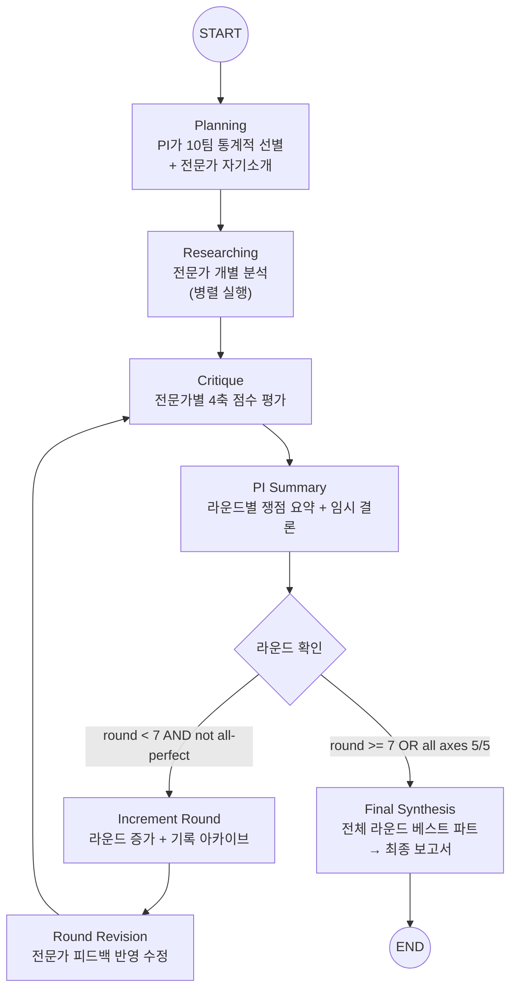

# Virtual Lab for NGT Safety Framework

유전자편집식품(NGT) 표준 안전성 평가 프레임워크를 도출하는 AI 에이전트 시스템

## 프로젝트 개요

**목표**: NGT 카테고리 전체에 적용 가능한 표준 안전성 평가 프레임워크를 AI 에이전트 팀 회의 시스템으로 도출

**핵심 아키텍처**: 다중 라운드 팀 회의 (Specialists + Critic + PI 전원 참여, 최대 7라운드, 만점 시 조기 종료)

- **PI Agent**: 전문가 팀 구성(10팀 통계적 선별), 라운드별 요약, 최종 보고서 작성
- **Specialist Agents**: PI가 동적으로 구성한 전문가 팀이 RAG + 웹 검색 + EFSA Journal 검색으로 개별 분석
- **Critic Agent**: 전문가별 4축(근거/범용성/비례성/가독성) 점수 + 개선 피드백

## Code & Prompt Availability

The full source code is publicly available in this repository. The agent
prompt templates and curated reference text assets used in the published
study are held privately at `prompts/` (gitignored), with sanitised
public placeholders at `prompts.example/`. The codebase is fully runnable
against either prompt set; the loader at `utils/prompt_loader.py` selects
the available directory automatically and respects the
`VIRTUAL_LAB_PROMPTS_DIR` environment variable for an explicit override.

The full prompt set — including the four-axis Critic rubric, the report
template, the decision-tree node wording, and the regulatory text
excerpts — is available from the corresponding author upon reasonable
request. This separation follows standard practice for evaluation
rubrics and assessment templates whose content overlaps with the
quantitative claims of the manuscript and would constitute target
leakage if released openly. See `prompts.example/README.md` for details.

The reproducibility study reported in §3.5 of the manuscript can be
re-executed end-to-end with `python run_experiment.py --run-id <N>`
and `python -m experiments.reproducibility.analyze`; see
`experiments/README.md`.

## 기술 스택

| 구분 | 기술 |
|------|------|
| Backend | FastAPI + LangGraph + httpx (OpenAI API 직접 호출) |
| Frontend | Next.js 16 + React 19 + Tailwind CSS 4 + react-markdown |
| LLM | GPT-5 (env `GPT_MODEL` 설정, 전 에이전트 공통) |
| Vector DB | Pinecone (규제 문서 316개) |
| Web Search | Tavily API (일반 + EFSA Journal 전용 검색) |
| Database | SQLite (세션/이벤트 히스토리 영속화) |
| Test | pytest (backend) + vitest (frontend) |
| Design | Stitch 디자인 시스템 |

## 워크플로우



### 라운드 진행 규칙

| 단계 | 노드 | 설명 |
|------|------|------|
| **R1** | researching → critique → pi_summary | 전문가 초기 분석 + 4축 비평 + 요약 |
| **R2~R6** | round_revision → critique → pi_summary | 피드백 반영 수정 + 재비평 (단조증가 강제) |
| **R7 또는 만점** | final_synthesis | 모든 축 5/5 도달 시 조기 종료, 아니면 7라운드까지 진행 후 합성 |

- **최대 라운드**: 7 (`workflow/graph.py: MAX_ROUNDS`)
- **조기 종료 조건**: 모든 전문가의 4축(evidence/universality/proportionality/readability)이 모두 5/5인 경우
- **점수 단조증가 강제**: 이전 약점 해결 시 점수 상승, 강점 유지 시 하락 금지
- **병렬 실행**: 전문가별 분석을 ThreadPoolExecutor로 동시 실행하여 속도 최적화
- 모든 라운드 내용이 프론트엔드에 **누적 표시** + SQLite에 영속 저장

## 빠른 시작

### 1. 환경 설정

```bash
git clone https://github.com/baesisi3648/pjt-virtual_lab.git
cd pjt-virtual_lab

python -m venv venv
source venv/bin/activate  # Windows: venv\Scripts\activate

pip install -r requirements.txt

# .env 파일 (.env.example 참고):
# OPENAI_API_KEY=sk-...
# TAVILY_API_KEY=tvly-...
# PINECONE_API_KEY=pcsk_...
# PINECONE_HOST=https://...
# PINECONE_INDEX_NAME=virtual-lab
# GPT_MODEL=gpt-5
```

### 2. 서버 실행

```bash
# 백엔드 (권장)
./restart_server.bat

# 또는 수동:
python -B -m uvicorn server:app --host 0.0.0.0 --port 8000 --reload

# 프론트엔드 (새 터미널)
cd frontend
npm install  # 최초 1회
npm run dev
```

### 3. 접속

- **Next.js UI**: http://localhost:3000
- **FastAPI Docs**: http://localhost:8000/docs

자세한 설치 절차는 [docs/SETUP_GUIDE.md](./docs/SETUP_GUIDE.md) 참조.

## 프로젝트 구조

```
pjt-virtual_lab/
├── agents/                 # AI 에이전트 (OpenAI SDK 직접 호출)
│   ├── scientist.py        # Specialist Agent - 분석 + 라운드 수정 (병렬)
│   ├── critic.py           # Critic Agent - 전문가별 4축 평가
│   ├── pi.py               # PI Agent - 10팀 선별 + 요약 + 최종보고서
│   └── factory.py          # 동적 전문가 프롬프트 생성
├── workflow/               # LangGraph 워크플로우
│   ├── state.py            # AgentState, CritiqueResult (다라운드 상태)
│   └── graph.py            # 최대 7라운드 + 만점 조기종료 StateGraph
├── utils/
│   └── llm.py              # OpenAI API 직접 호출 (httpx + 에러 재시도)
├── tools/                  # LangChain Tools
│   ├── rag_search.py       # Pinecone RAG 검색
│   └── web_search.py       # Tavily 웹 + EFSA Journal 전용 검색
├── data/
│   └── guidelines.py       # 연구 아젠다 + 학술 톤 가이드 + 평가 루브릭
├── rag/                    # RAG 시스템 (Pinecone, OpenAI embeddings)
├── frontend/               # Next.js 16 프론트엔드
│   └── src/
│       ├── app/
│       │   ├── page.tsx        # Dashboard (홈)
│       │   ├── timeline/       # Agents - 실시간 SSE 타임라인
│       │   ├── reports/        # Reports - 보고서 목록 / 뷰어
│       │   ├── history/        # History - 세션 기록 (DB 기반)
│       │   └── game/           # → /timeline 리다이렉트
│       └── components/
│           ├── ProcessTimeline.tsx
│           ├── ReportEditor.tsx
│           └── game/           # ChatLog, RoundProgressBar (Pipeline 스타일)
├── server.py               # FastAPI 서버 (REST + SSE + 보고서/세션 관리)
├── db.py                   # SQLite 세션/이벤트 히스토리
├── config.py               # Pydantic Settings
├── reports/                # 생성된 보고서 (.md) 저장소
├── restart_server.bat      # 서버 재시작 (캐시 삭제 포함)
├── docs/
│   ├── SETUP_GUIDE.md
│   ├── ARCHITECTURE_EXPLAINED.md
│   └── workflow-diagram.mmd
└── tests/                  # pytest 테스트
```

## 주요 기능

### 1. 다중 라운드 팀 회의 시스템 (최대 7라운드)
- PI가 연구 주제에 맞는 전문가 팀을 **10팀 통계적 선별**로 결정
- 모든 에이전트가 라운드별로 **반복 토론**, 피드백 단조증가 강제
- Critic이 전문가별로 **4축(evidence/universality/proportionality/readability)** 점수 부여
- **만점(all 5/5) 시 조기 종료** — 비용/시간 최적화
- 라운드별 회의록이 `meeting_history`에 아카이브 + SQLite 영속화

### 2. Live Process Timeline (SSE)
- Stitch 디자인 시스템 기반 Pipeline 스타일 ChatLog
- 에이전트별 실시간 활동 모니터링 + 캐릭터 시각화
- 라운드 구분선 + 전문가별 4축 점수/피드백 패널
- 전체 라운드 누적 표시

### 3. Reports & History
- 생성된 보고서 자동 저장 (`reports/*.md`) + 목록/뷰어/삭제/번역 지원
- SQLite 기반 세션 히스토리 (전체 이벤트 재현 가능)
- History 페이지에서 전체 복사 / TXT 저장 지원

### 4. 보고서 품질 개선
- 학술 톤 가이드 + 5대 핵심 연구 아젠다 자동 주입
- Mermaid Decision Tree (SDN-1/2/3/ODM 의사결정 흐름도)
- 발화 통계(에이전트별 발화 횟수/글자수) + 라운드별 소요시간 자동 삽입
- API 서버 에러 자동 재시도

### 5. RAG + Web Search
- **Pinecone RAG**: 316개 규제 문서 벡터 검색 (OpenAI embeddings)
- **Tavily Web Search**: .gov, nature.com, sciencedirect.com 우선 검색
- **EFSA Journal Search**: efsa.onlinelibrary.wiley.com 전용 검색
- Round 1 검색 결과 캐싱으로 반복 호출 최소화

## API 엔드포인트

### 워크플로우
| Method | Path | 설명 |
|--------|------|------|
| POST | `/api/research/stream` | 워크플로우 SSE 스트리밍 (실시간 이벤트) |
| POST | `/api/research` | 워크플로우 동기 실행 |
| POST | `/api/research/async` | Celery 비동기 실행 (선택) |
| GET | `/api/task/{task_id}` | Celery 태스크 상태 조회 |

### 보고서
| Method | Path | 설명 |
|--------|------|------|
| GET | `/api/reports` | 보고서 목록 |
| GET | `/api/reports/{filename}` | 보고서 메타데이터 |
| GET | `/api/reports/{filename}/content` | 보고서 본문 |
| DELETE | `/api/reports/{filename}` | 보고서 삭제 |
| POST | `/api/report/regenerate` | 보고서 섹션 재생성 |
| POST | `/api/reports/translate` | 보고서 번역 |

### 세션 히스토리
| Method | Path | 설명 |
|--------|------|------|
| GET | `/api/sessions` | 세션 목록 |
| GET | `/api/sessions/{session_id}` | 세션 상세 |
| GET | `/api/sessions/{session_id}/events` | 세션 이벤트 전체 |

### 기타
| Method | Path | 설명 |
|--------|------|------|
| GET | `/health` | 헬스체크 |
| GET | `/api/celery/health` | Celery 상태 |
| GET | `/api/debug/modules` | 로드된 모듈 검증 |

### SSE 이벤트 예시
```
data: {"type": "start", "message": "연구 프로세스 시작..."}
data: {"type": "phase", "phase": "researching", "round": 1}
data: {"type": "agent", "agent": "scientist", "message": "..."}
data: {"type": "decision", "specialist_feedback": {...}, "scores": {"role": {"evidence": 4, "universality": 3, ...}}}
data: {"type": "iteration", "round": 2, "message": "라운드 2 시작"}
data: {"type": "complete", "report": "...", "rounds": 5}
```

## 테스트

```bash
# Backend
pytest tests/ -v

# Frontend
cd frontend && npm test
```

## 문제 해결

### 서버가 새 코드를 반영하지 않는 경우
```bash
./restart_server.bat   # 프로세스 종료 + __pycache__ 삭제 + 재시작
```

### 프론트엔드가 API를 찾지 못하는 경우
```bash
curl http://localhost:8000/health
```

### Pinecone 연결 에러
```bash
# .env에 다음 값 확인:
# PINECONE_API_KEY=pcsk_...
# PINECONE_HOST=https://...
# PINECONE_INDEX_NAME=virtual-lab
```

## 모델 설정

| 환경변수 | 기본값 | 용도 |
|----------|--------|------|
| `GPT_MODEL` | `gpt-5` (.env) / `gpt-4o` (config 폴백) | 전 에이전트 (PI / Critic / Specialists) 공통 |

`utils/llm.py`의 `call_gpt()`가 단일 진입점이며, `call_gpt4o()` / `call_gpt4o_mini()`는 하위 호환용 alias.

## 참고 문서

- [docs/SETUP_GUIDE.md](./docs/SETUP_GUIDE.md): 설치 및 실행 가이드
- [docs/ARCHITECTURE_EXPLAINED.md](./docs/ARCHITECTURE_EXPLAINED.md): 아키텍처 상세
- [docs/workflow-diagram.mmd](./docs/workflow-diagram.mmd): 워크플로우 Mermaid 다이어그램
- [docs/project-proposal-report.md](./docs/project-proposal-report.md): 프로젝트 제안서
- [CLAUDE.md](./CLAUDE.md): 프로젝트 개발 메모

## 라이선스

MIT License

---

**Built with**: FastAPI · LangGraph · Next.js 16 · GPT-5 · Pinecone · Tavily · SQLite · Stitch Design
