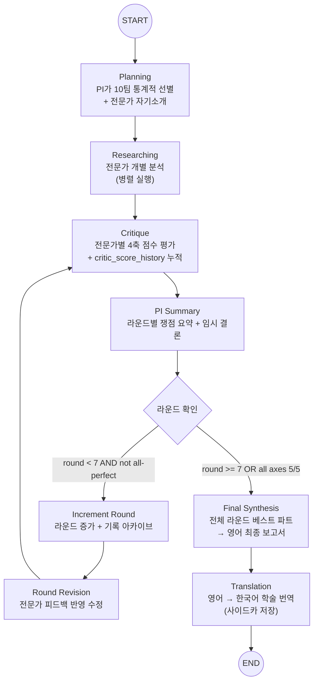

# Virtual Lab for NGT Safety Framework

유전자편집식품(NGT) 표준 안전성 평가 프레임워크를 도출하는 다중 에이전트 시스템.
Agentic AI orchestration for the safety assessment of genome-edited foods.

---

## Code & Prompt Availability

The full source code is publicly available in this repository. The agent
prompt templates and curated reference text assets used in the published
study are held privately at `prompts/` (gitignored), with sanitised public
placeholders at `prompts.example/`. The codebase is fully runnable against
either prompt set; the loader at `utils/prompt_loader.py` selects the
available directory automatically and respects the
`VIRTUAL_LAB_PROMPTS_DIR` environment variable for an explicit override.

The full prompt set — including the four-axis Critic rubric, the report
template, the decision-tree node wording, and the regulatory text excerpts
— is available from the corresponding author upon reasonable request.
This separation follows standard practice for evaluation rubrics and
assessment templates whose content overlaps with the quantitative claims
of the manuscript and would constitute target leakage if released openly.
See `prompts.example/README.md` for details.

The reproducibility study reported in §3.5 of the manuscript can be
re-executed end-to-end with `python run_experiment.py --run-id <N>` and
`python -m experiments.reproducibility.analyze`; see `experiments/README.md`.

---

## 프로젝트 개요

**목표**: NGT 카테고리 전체에 적용 가능한 표준 안전성 평가 프레임워크를 AI 에이전트
팀 회의 시스템으로 도출.

**핵심 아키텍처**: 다중 라운드 팀 회의 (Specialists + Critic + PI 전원 참여, 최대 7라운드,
모든 축 5/5 만점 시 조기 종료) + 영어 보고서 자동 생성 + 한글 사이드카 번역.

- **PI Agent**: 10팀 통계적 선별로 전문가 팀 구성 → 라운드별 종합 → 최종 보고서 작성
- **Specialist Agents**: 5명 도메인 전문가가 RAG + 웹 + EFSA Journal 검색을 활용해 병렬 분석
- **Scientific Critic Agent**: 4축(evidence / universality / proportionality / readability)
  점수 + 전문가별 개선 피드백
- **Translator Agent**: 워크플로우 종료 시 영어 최종 보고서를 학술 한국어로 자동 번역,
  사이드카(`*.ko.txt`)로 저장 → 프론트엔드 토글 즉시 전환

---

## 기술 스택

| 구분 | 기술 |
|------|------|
| Backend | FastAPI + LangGraph + httpx (OpenAI API 직접 호출) |
| Frontend | Next.js 16 + React 19 + Tailwind CSS 4 + react-markdown |
| LLM | GPT-5 (env `GPT_MODEL`, 전 에이전트 공통; 기본 `temperature=0.2`) |
| Embeddings | OpenAI `text-embedding-3-large` (재현성 분석용) |
| Vector DB | Pinecone (Codex GL44/45, EU NGT 2025, EFSA novel-food guidance 등) |
| Web Search | Tavily API (NGT 약어 충돌 방지 헬퍼 적용) + 전용 EFSA Journal 검색 |
| Database | SQLite (세션/이벤트 히스토리 영속화) |
| Analysis | numpy + matplotlib (재현성 figures + CSV) |
| Test | pytest (backend) + vitest (frontend) |

---

## 워크플로우



### 라운드 진행 규칙

| 단계 | 노드 | 설명 |
|------|------|------|
| **R1** | researching → critique → pi_summary | 전문가 초기 분석 + 4축 비평 + 요약 |
| **R2~R6** | round_revision → critique → pi_summary | 피드백 반영 수정 + 재비평 (단조증가 강제) |
| **R7 또는 만점** | final_synthesis → translation | 모든 축 5/5 도달 시 조기 종료, 아니면 7라운드까지 |

- **최대 라운드**: 7 (`workflow/graph.py: MAX_ROUNDS`)
- **조기 종료**: 모든 전문가 × 4축 = 모두 5/5인 경우
- **점수 단조증가 강제**: 이전 강점 유지 + 약점 해결 시 점수 상승, 하락 금지
- **병렬 실행**: 전문가 분석을 ThreadPoolExecutor로 동시 실행
- **언어 정책**: 영어가 1차, 한국어 사이드카는 토글 시 즉시 전환

---

## Reproducibility Study (manuscript §3.5)

논문 §3.5의 재현성 검증을 위한 인프라가 포함되어 있다. 동일 agenda에 대해 N회
독립 실행하여 두 정량 지표를 산출한다.

```bash
# 1. N회 독립 실행 — 각 실행은 ~16-24분 소요
python run_experiment.py --run-id 1
python run_experiment.py --run-id 2
python run_experiment.py --run-id 3
python run_experiment.py --run-id 4
python run_experiment.py --run-id 5

# 2. 분석 (similarity matrix + critic CV + figures)
python -m experiments.reproducibility.analyze
```

각 실행은 `experiments/runs/run_<ID>/`에 자체 완결형 dossier를 저장한다:
- `final_report.md` — 영어 최종 보고서
- `final_report.ko.md` — 한국어 사이드카 번역
- `critic_scores.json` — 라운드별 4축 점수 history
- `meta.json` — 실행시간, 팀 구성, 출처 등 메타데이터
- `messages.json` — 전체 에이전트 메시지 로그

분석 스크립트가 산출하는 파일:
- `similarity_matrix.csv` — 5×5 cosine 유사도 (text-embedding-3-large, chunked mean-pool)
- `critic_cv.csv` — 라운드 × 축 × {mean, SD, CV}
- `figures/figure2c_critic_trajectory.png` — N=5 평균 ± SD trajectory
- `figures/figure2d_similarity_heatmap.png` — 5×5 cosine heatmap
- `manuscript_numbers.md` — 본문 §3.1 / §2.6 / §3.5에 paste-ready

### Reported figures (N = 5)

| 지표 | 값 |
|------|-----|
| 평균 deliberation time | **18 min 46 s ± 3 min 58 s** (range 12 min 56 s – 24 min 18 s) |
| 평균 라운드 수 | 4.2 |
| 영어 보고서 평균 길이 | 36,461 ± 3,416 chars |
| Pairwise semantic similarity (10 pairs) | **0.949 ± 0.021** (min 0.910, max 0.978) |
| Critic-score CV — Evidence/Universality/Proportionality (R3 onward) | **0.000** |
| Critic-score CV — Readability (R6) | 0.000 |

상세 결과: `experiments/reproducibility/results/manuscript_numbers.md`.

---

## 빠른 시작

### 1. 환경 설정

```bash
git clone https://github.com/baesisi3648/pjt-virtual_lab.git
cd pjt-virtual_lab

python -m venv venv
source venv/bin/activate  # Windows: venv\Scripts\activate

pip install -r requirements.txt

# .env 파일 (.env.example 참고):
# OPENAI_API_KEY=sk-...
# TAVILY_API_KEY=tvly-...
# PINECONE_API_KEY=pcsk_...
# PINECONE_HOST=https://...
# PINECONE_INDEX_NAME=virtual-lab
# GPT_MODEL=gpt-5
# VIRTUAL_LAB_TEMPERATURE=0.2          # optional
# VIRTUAL_LAB_PROMPTS_DIR=/path/to/prompts  # optional override
```

### 2. 서버 실행

```bash
# 백엔드 (권장)
./restart_server.bat

# 또는 수동:
python -B -m uvicorn server:app --host 0.0.0.0 --port 8000 --reload

# 프론트엔드 (새 터미널)
cd frontend
npm install   # 최초 1회
npm run dev
```

### 3. 단일 실행 (CLI)

```bash
python run_experiment.py --run-id smoke
# → experiments/runs/run_smoke/ 에 dossier 저장
```

### 4. 접속

- **Next.js UI**: http://localhost:3000
- **FastAPI Docs**: http://localhost:8000/docs

자세한 설치 절차: [docs/SETUP_GUIDE.md](./docs/SETUP_GUIDE.md).

---

## 프로젝트 구조

```
pjt-virtual_lab/
├── agents/                 # AI 에이전트 (OpenAI SDK 직접 호출 — bind_tools 미사용)
│   ├── scientist.py        # Specialist — 분석 + 라운드 수정 (병렬)
│   ├── critic.py           # Critic — 전문가별 4축 평가 + history 누적
│   ├── pi.py               # PI — 10팀 선별 + 라운드 종합 + 최종 보고서
│   ├── translator.py       # 영어 → 한국어 학술 번역 (사이드카 자동 생성)
│   └── factory.py          # 동적 specialist 프롬프트 생성
├── workflow/
│   ├── state.py            # AgentState (critic_score_history, run_id 포함)
│   └── graph.py            # planning → … → final_synthesis → translation → END
├── utils/
│   ├── llm.py              # OpenAI API httpx 직접 호출 + 에러 재시도
│   ├── prompt_loader.py    # prompts/ 또는 prompts.example/ 자동 로드
│   └── search_query.py     # NGT 약어 충돌 방지 헬퍼 (5개 호출 사이트 통합)
├── tools/
│   ├── rag_search.py       # Pinecone RAG 검색
│   └── web_search.py       # Tavily 웹 + EFSA Journal 전용 검색
├── data/
│   └── guidelines.py       # 외부 prompts/data/*.md 로더 (research_agenda 등)
├── prompts/                # 🔒 GITIGNORED — author-private prompt assets
│   ├── system/             # PI / Critic / Specialist / Translator 시스템 프롬프트
│   └── data/               # 연구 아젠다, Codex 원칙, 채점 rubric 등
├── prompts.example/        # 공개용 sanitised placeholder (로더 fallback)
├── experiments/
│   ├── runs/               # 실행별 dossier (gitignored, 로컬만)
│   │   └── run_<ID>/
│   │       ├── final_report.md / final_report.ko.md
│   │       ├── critic_scores.json
│   │       ├── meta.json
│   │       └── messages.json
│   ├── reproducibility/
│   │   ├── analyze.py      # 5회 결과 → similarity + CV + figures
│   │   └── results/        # CSV + manuscript_numbers.md + figures/
│   └── README.md           # 재현 절차 안내
├── docs/
│   ├── SETUP_GUIDE.md
│   ├── ARCHITECTURE_EXPLAINED.md
│   ├── manuscript_revisions.md   # 논문 본문 line-by-line 수정 가이드
│   └── figure_design_prompts.md  # Figure 1, 2 Claude Design 프롬프트
├── frontend/               # Next.js 16 + React 19
│   └── src/
│       ├── app/
│       │   ├── page.tsx        # Dashboard
│       │   ├── timeline/       # SSE 타임라인
│       │   ├── reports/        # 보고서 목록 + 뷰어 (EN/KO 토글)
│       │   ├── history/        # 세션 기록 (DB 기반)
│       │   └── game/           # → /timeline 리다이렉트
│       └── components/
│           ├── ProcessTimeline.tsx
│           ├── ReportEditor.tsx
│           └── game/           # ChatLog, RoundProgressBar
├── server.py               # FastAPI 서버 (REST + SSE + 보고서/세션 관리)
├── run_experiment.py       # 재현성 실행 CLI (--run-id <N>)
├── db.py                   # SQLite 세션/이벤트 히스토리
├── config.py               # Pydantic Settings
├── reports/                # 워크플로우가 생성한 영어 보고서 + .ko.txt 사이드카
├── restart_server.bat      # 서버 재시작 (캐시 삭제 포함)
└── tests/                  # pytest
```

---

## 주요 기능

### 1. 다중 라운드 팀 회의 (최대 7라운드)
- PI가 연구 주제에 맞는 전문가 팀을 **10팀 통계적 선별**로 결정
- 모든 에이전트가 라운드별로 **반복 토론**, 점수 단조증가 강제
- Critic이 전문가별로 **4축(evidence/universality/proportionality/readability)** 1~5점 부여
- **만점(all 5/5) 시 조기 종료** — 비용/시간 최적화
- 라운드별 회의록을 `meeting_history`에 아카이브 + SQLite 영속화

### 2. 영어 우선 + 한국어 사이드카
- 워크플로우는 영어로 모든 단계 진행 → 영어 최종 보고서 생성
- 종료 직후 `agents.translator`가 학술 한국어 번역 1회 호출
- `reports/` 에 `report_<ts>_<topic>.txt` (영어 primary) + `.ko.txt` (사이드카) 동시 저장
- 프론트엔드에서 EN/KO 토글 = 즉시 전환 (추가 API 호출 0)

### 3. Critic Score Trajectory
- 매 라운드 종료 시 4축 점수가 `critic_score_history`에 누적
- 최종 보고서에 표 + Mermaid `xychart-beta` 그래프 자동 삽입
- 5회 실행 결과는 `experiments/reproducibility/analyze.py`로 N=5 평균 ± SD 그래프

### 4. RAG + Web Search (NGT 약어 충돌 방지)
- **Pinecone RAG**: 인덱스된 규제 문서 (Codex GL44/45, EU NGT 2025 등)
- **Tavily Web Search**: 일반 웹 (정책/문헌)
- **EFSA Journal Search**: `efsa.onlinelibrary.wiley.com` 전용 스코프
- `utils/search_query.disambiguate()` 헬퍼가 5개 호출 사이트에서 NGT 약어 충돌
  (nasogastric tube / natural gas technology 등) 방지
- Round 1 검색 결과 캐싱으로 라운드 간 반복 호출 최소화

### 5. Reports & History
- 영어 + 한국어 자동 사이드카 (`*.ko.txt`)
- SQLite 기반 세션 히스토리 (전체 이벤트 재현 가능)
- History 페이지에서 전체 복사 / TXT 저장
- `/api/reports/translate`는 EN → KO 방향 (사이드카 누락 시 fallback)

### 6. 재현성 인프라
- `run_experiment.py` CLI = 1회 실행 + dossier 자동 저장
- `experiments.reproducibility.analyze` = N회 결과 → 메트릭 + figures
- 두 정량 지표: **(a) cross-run semantic similarity, (b) per-round per-axis CV**
- `manuscript_numbers.md` = paste-ready 본문 갱신 자료

---

## API 엔드포인트

### 워크플로우
| Method | Path | 설명 |
|--------|------|------|
| POST | `/api/research/stream` | SSE 스트리밍 (실시간 이벤트, translation 노드 포함) |
| POST | `/api/research` | 동기 실행 (영어 + 한국어 모두 반환) |
| POST | `/api/research/async` | Celery 비동기 실행 (선택) |
| GET | `/api/task/{task_id}` | Celery 태스크 상태 조회 |

### 보고서
| Method | Path | 설명 |
|--------|------|------|
| GET | `/api/reports` | 보고서 목록 (영어 primary만 노출, 사이드카 필터링) |
| GET | `/api/reports/{filename}/content?lang=en\|ko` | 영어/한국어 본문 선택 |
| DELETE | `/api/reports/{filename}` | 보고서 + 사이드카 동시 삭제 |
| POST | `/api/report/regenerate` | 보고서 섹션 재생성 |
| POST | `/api/reports/translate` | 영어 → 한국어 (`agents.translator.translate_en_to_ko`) |

### 세션 히스토리
| Method | Path | 설명 |
|--------|------|------|
| GET | `/api/sessions` | 세션 목록 |
| GET | `/api/sessions/{session_id}` | 세션 상세 |
| GET | `/api/sessions/{session_id}/events` | 세션 이벤트 전체 |

### 기타
| Method | Path | 설명 |
|--------|------|------|
| GET | `/health` | 헬스체크 |
| GET | `/api/celery/health` | Celery 상태 |
| GET | `/api/debug/modules` | 로드된 모듈 검증 (bind_tools 미사용 확인) |

### SSE 이벤트 타입
```
start | phase | agent | decision | iteration | translation | complete | error
```

---

## 테스트

```bash
# Backend
pytest tests/ -v

# Frontend
cd frontend && npm test
```

---

## 문제 해결

### 서버가 새 코드를 반영하지 않는 경우
```bash
./restart_server.bat   # 프로세스 종료 + __pycache__ 삭제 + 재시작
```

### 프론트엔드가 API를 찾지 못하는 경우
```bash
curl http://localhost:8000/health
```

### Pinecone 연결 에러
```bash
# .env 확인:
# PINECONE_API_KEY=pcsk_...
# PINECONE_HOST=https://...
# PINECONE_INDEX_NAME=virtual-lab
```

### `experiments/reproducibility/analyze.py`가 HTTP 400 반환
- 보고서가 `text-embedding-3-large` 8,191 토큰 한계 초과 → 청킹 mean-pool로 자동 처리됨
- 그래도 실패하면 `--skip-embeddings` 플래그로 CV만 산출 가능

---

## 모델 / 환경 변수

| 변수 | 기본값 | 용도 |
|------|--------|------|
| `GPT_MODEL` | `gpt-5` | 전 에이전트 공통 |
| `VIRTUAL_LAB_TEMPERATURE` | `0.2` | 재현성 향상 (lower = more deterministic) |
| `VIRTUAL_LAB_PROMPTS_DIR` | (auto) | `prompts/` 또는 `prompts.example/` 위치 override |
| `EMBEDDING_MODEL` | `text-embedding-3-large` | 재현성 분석용 임베딩 |
| `OPENAI_API_KEY` / `TAVILY_API_KEY` / `PINECONE_API_KEY` / `PINECONE_HOST` | — | API 인증 |

`utils/llm.py`의 `call_gpt()`가 단일 진입점이며, `call_gpt4o()` / `call_gpt4o_mini()`는 하위 호환용 alias.

---

## 참고 문서

- [docs/SETUP_GUIDE.md](./docs/SETUP_GUIDE.md) — 설치 및 실행 가이드
- [docs/ARCHITECTURE_EXPLAINED.md](./docs/ARCHITECTURE_EXPLAINED.md) — 아키텍처 상세
- [docs/manuscript_revisions.md](./docs/manuscript_revisions.md) — 논문 본문 line-by-line 수정 가이드
- [docs/figure_design_prompts.md](./docs/figure_design_prompts.md) — Figure 1, 2 Claude Design 프롬프트
- [experiments/README.md](./experiments/README.md) — 재현성 실험 절차
- [prompts.example/README.md](./prompts.example/README.md) — 프롬프트 비공개 정책 안내
- [CLAUDE.md](./CLAUDE.md) — 프로젝트 개발 메모

---

## 라이선스

MIT License

---

**Built with**: FastAPI · LangGraph · Next.js 16 · GPT-5 · OpenAI Embeddings · Pinecone · Tavily · SQLite · numpy · matplotlib
